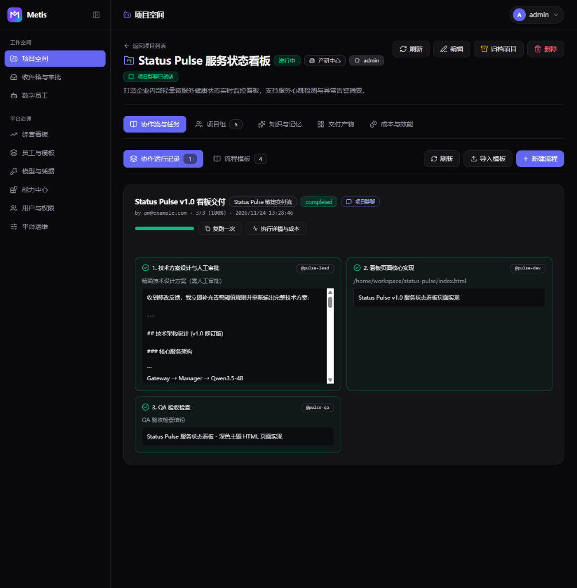
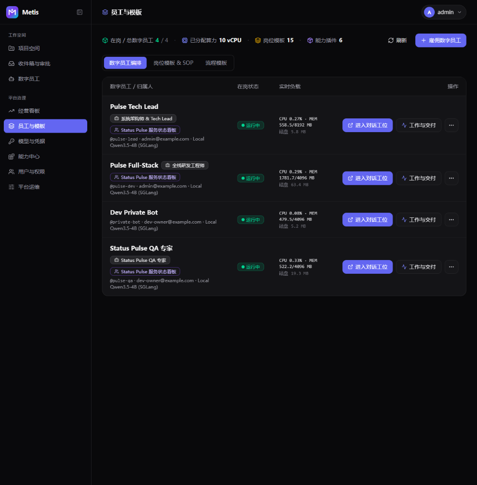
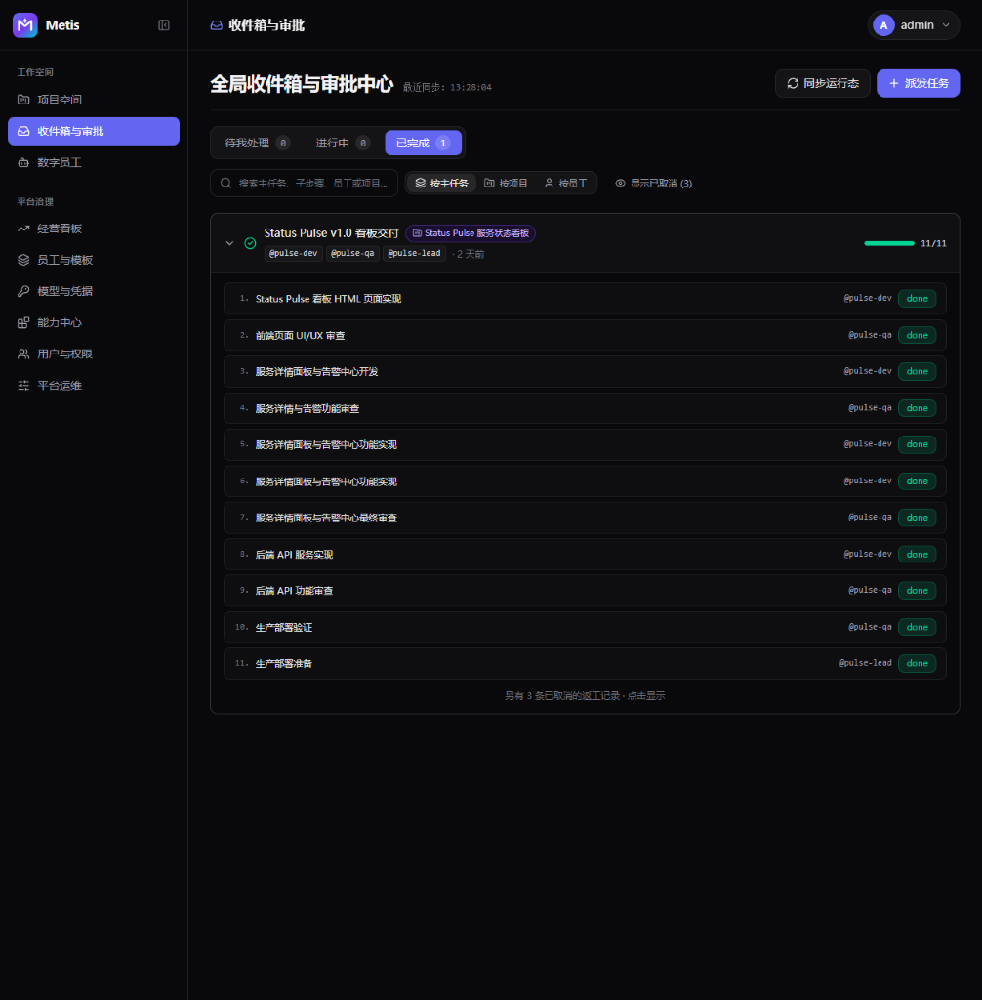
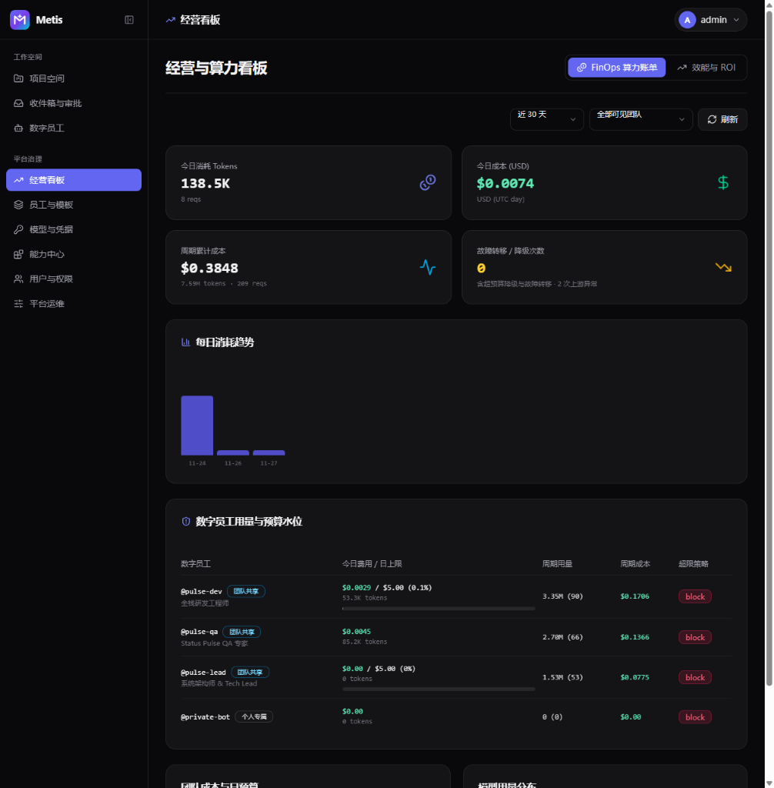
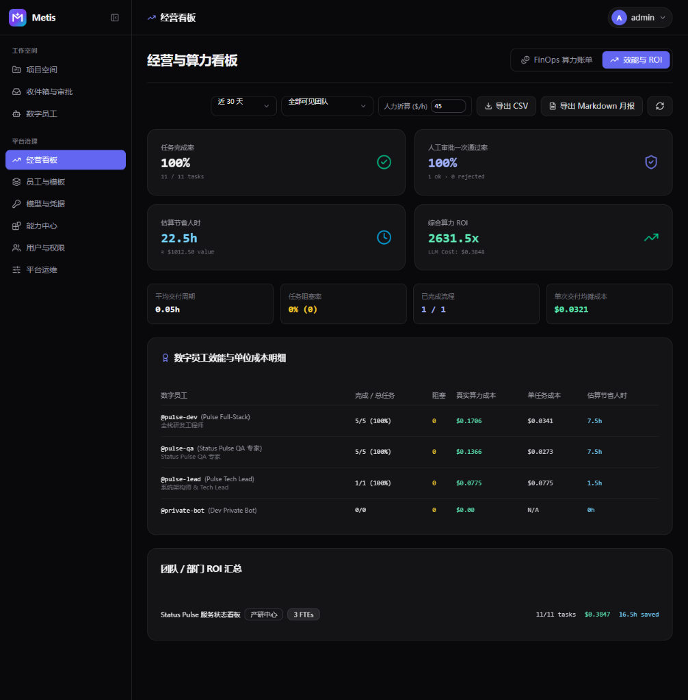
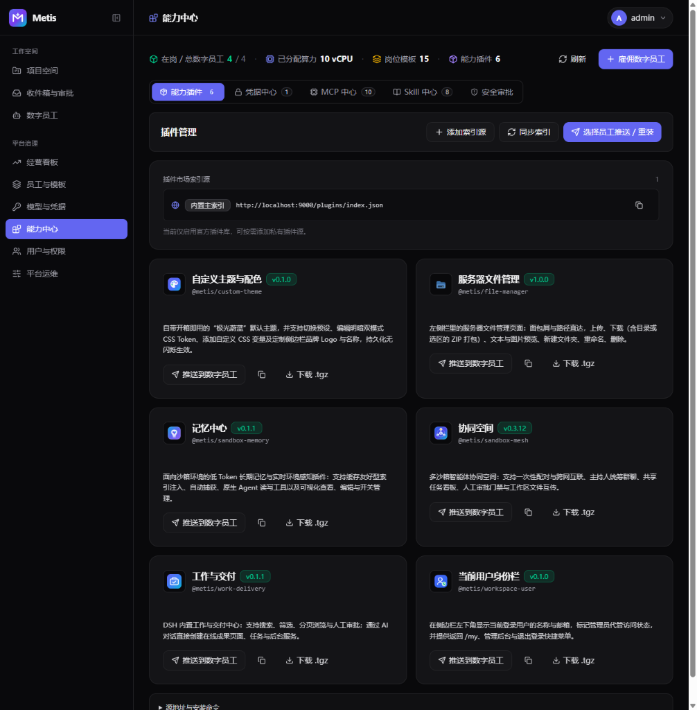
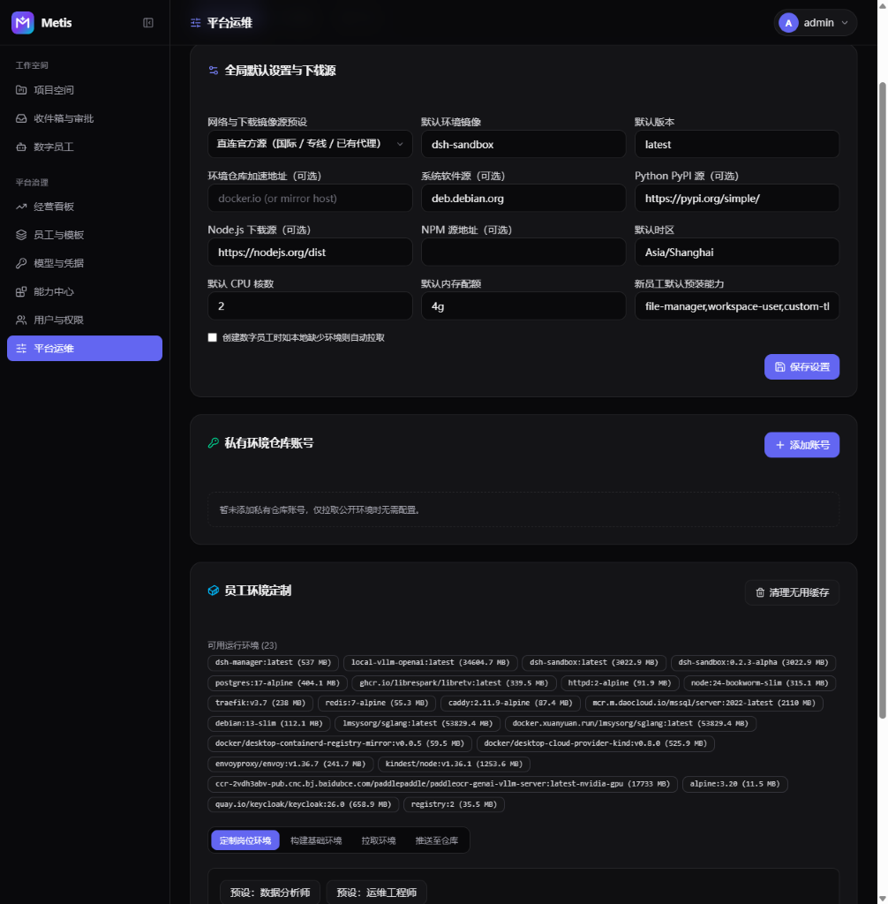
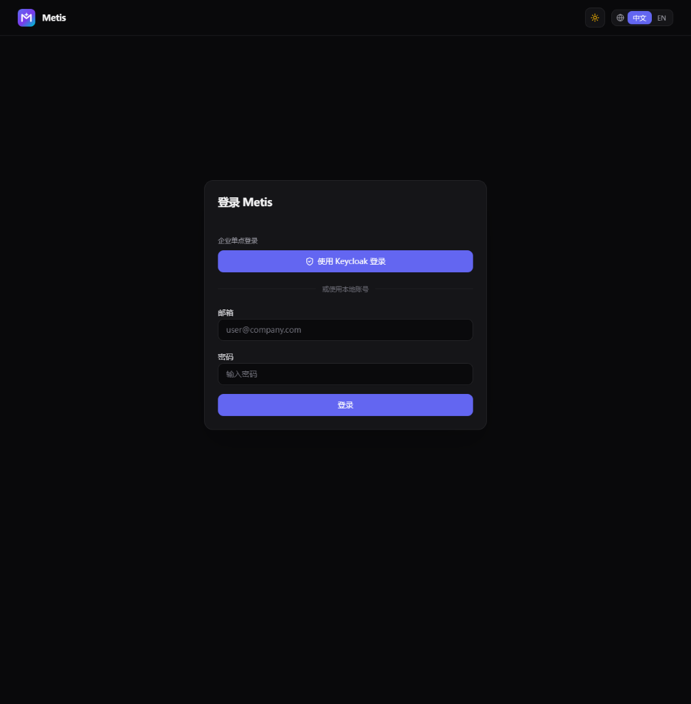

<p align="center">
  
</p>

<h1 align="center">Metis</h1>

<p align="center">
  <strong>Self-Hosted Enterprise AI Workforce Cloud &amp; Multi-Agent Collaboration Platform</strong><br/>
  Turn standalone AI agents into an organized digital workforce that plans, builds, reviews, and ships together — with zero-trust LLM governance, visual workflows, and 60-second setup.
</p>

<p align="center">
  <a href="LICENSE"></a>
  
  
  
  
  
</p>

<p align="center">
  <strong>English</strong> · <a href="README.zh-CN.md">简体中文</a>
</p>

<p align="center">
  <a href="#why-metis">Why Metis</a> ·
  <a href="#product-tour">Product Tour</a> ·
  <a href="#60-second-quick-start">Quick Start</a> ·
  <a href="#key-capabilities">Capabilities</a> ·
  <a href="#architecture">Architecture</a> ·
  <a href="#running-tests">Tests</a>
</p>

---

<p align="center">
  
</p>

<p align="center">
  <sub>Multi-role AI workflow running inside a Metis Project Workspace — Tech Lead, Full-Stack Developer, and QA collaborate end-to-end with human approval checkpoints and shared project context.</sub>
</p>

---

## Why Metis

Standalone coding bots live in ephemeral chats — they forget decisions, share raw API keys in plaintext, lack approval guardrails, and are hard to roll out across a company. **Metis** gives every digital employee a persistent, isolated cloud workspace backed by enterprise governance:

- **Zero-Config Deployment, Browser-First Ops**: Start the entire stack with one `docker compose up -d` — no manual `.env` secrets required. A 3-step Setup Wizard handles administrator initialization, regional mirror presets, in-UI base & role-specific image builds, private container registries, and first LLM verification.
- **Project Teams & Visual Multi-Agent Workflows**: Assemble cross-functional digital teams in one click with automatic pairwise encrypted pairing (`sandbox-mesh`), shared directories, and visual workflows supporting DAG dependencies, parallel stages, SLA timeouts, auto-retry/rework loops, schedules, and inbound webhooks.
- **Zero-Trust LLM Gateway, DLP & Real-Time ROI**: Provider API keys never enter employee containers. Meter every streaming token (including Anthropic cache creation & cache read pricing), enforce daily/monthly USD caps and RPM/TPM limits, auto-failover across upstream Key Pools, redact sensitive outbound data, and export executive ROI scorecards.
- **Enterprise Governance Built In**: Unified single-entry login with multiple Enterprise SSO (OIDC) providers, role-based access, high-risk tool Human-in-the-Loop approvals, encrypted Developer Credentials & GitHub App auto-renewing tokens, MCP & `.zip` Skill bundles, and multi-worker HA coordination.

---

## Product Tour

<table>
  <tr>
    <td width="50%" valign="top">
      <a href="docs/images/digital-workforce.png"></a>
      <br />
      <strong>Digital Workforce &amp; Live Telemetry</strong><br />
      <sub>Monitor active digital employees, CPU/memory/disk usage, bound LLMs, idle auto-sleep/auto-wake policies, and launch into any workspace in one click.</sub>
    </td>
    <td width="50%" valign="top">
      <a href="docs/images/inbox-tasks.png"></a>
      <br />
      <strong>Global Inbox &amp; Approval Center</strong><br />
      <sub>Track cross-employee multi-step delivery chains grouped by parent task or project, approve workflow gates, and resolve high-risk tool requests in one place.</sub>
    </td>
  </tr>
  <tr>
    <td width="50%" valign="top">
      <a href="docs/images/finops-ledger.png"></a>
      <br />
      <strong>LLM FinOps &amp; Budget Guardrails</strong><br />
      <sub>Real-time token and USD ledger with daily spend trends, per-employee budget bars, rate limits, failover tracking, and automatic block/downgrade actions.</sub>
    </td>
    <td width="50%" valign="top">
      <a href="docs/images/roi-scorecard.png"></a>
      <br />
      <strong>Executive ROI &amp; Efficiency Scorecard</strong><br />
      <sub>Measure task completion rate, first-pass human approval rate, estimated hours saved, unit cost per task, and export CSV or Markdown monthly reports.</sub>
    </td>
  </tr>
  <tr>
    <td width="50%" valign="top">
      <a href="docs/images/capabilities-center.png"></a>
      <br />
      <strong>Capabilities, Vault, MCP &amp; Skills</strong><br />
      <sub>Hot-push built-in <code>@metis/*</code> plugins, GitHub App &amp; SSH/PAT credentials, 10 built-in MCP servers, Skill <code>.zip</code> packages, and tool approval rules without container restarts.</sub>
    </td>
    <td width="50%" valign="top">
      <a href="docs/images/environment-builder.png"></a>
      <br />
      <strong>Environment Builder &amp; Private Registries</strong><br />
      <sub>Configure hot-reloaded network mirrors across workers, manage Fernet-encrypted private Docker registries, pull upstream images, or build custom role environments directly in the UI.</sub>
    </td>
  </tr>
</table>

<details>
<summary><strong>Preview Unified Sign-In &amp; Enterprise SSO Entry</strong></summary>
<p align="center">
  
</p>
</details>

---

## 60-Second Quick Start

### Zero-Config Docker Compose (Recommended)

You do **not** need to hand-craft `.env` secrets or pre-build employee images manually:

```bash
git clone https://github.com/wangchengxin666/metis.git
cd metis/manager
docker compose up -d --build
```

> **Optional fast mirrors during image build (e.g. China mainland):**
> ```bash
> APT_MIRROR=https://mirrors.aliyun.com \
> PIP_INDEX_URL=https://mirrors.aliyun.com/pypi/simple/ \
> NPM_REGISTRY=https://registry.npmmirror.com \
> docker compose up -d --build
> ```

1. Grab your one-time **Setup Code** from the startup logs (also persisted to `/data/INITIAL_SETUP_CODE.txt`):
   ```bash
   docker compose logs manager | grep "Setup Code"
   ```
2. Open **`http://localhost:9000`** in your browser.
3. Complete the **3-Step Setup Wizard**:
   - **Step 1**: Enter the Setup Code, create your admin email & password, set brand name, and pick a network mirror preset.
   - **Step 2**: One-click pull or build the digital employee base environment directly in the UI.
   - **Step 3**: Connect your first LLM provider (OpenAI, Anthropic, Gemini, or local SGLang/vLLM) and test live connectivity before entering the console.

### Optional Production Overrides (`manager/.env`)

Copy [manager/.env.example](manager/.env.example) to `manager/.env` only when connecting external infrastructure:

- **External Database (`DATABASE_URL`)**: Supports PostgreSQL (`postgresql+psycopg://...`), **Microsoft SQL Server** (`mssql+pymssql://...` / `mssql://...`), MySQL (`mysql+pymysql://...`), or opt-in SQLite (`ALLOW_SQLITE=true`).
- **Kubernetes Runtime (`SANDBOX_RUNTIME=kubernetes`)**: Provisions per-employee `StatefulSet`, `PVC`, `Service`, Traefik CRDs/HTTP Provider, and synced `ImagePullSecrets`. See [deploy/kubernetes](deploy/kubernetes).
- **Remote Docker over TLS (`DOCKER_HOST=tcp://...`)**: Allocates ephemeral ports securely over TLS and routes dynamically via Traefik.

---

## Key Capabilities

### 1. Project Workspaces, Workflows & Memory Recall
- **14+ Company-Wide Role Templates**: One-click import covering **Engineering** (*Tech Lead, Full-Stack, Frontend, Backend, QA, DevOps/SRE, Product Manager, Security Auditor*) and **Business** (*Executive Assistant, Finance Analyst, Legal & Compliance, HR Specialist, Marketing & Growth, BI Data Analyst*).
- **Declarative Multi-Stage Workflows**: Visual editor + YAML/JSON import/export supporting parallel waves, DAG `depends_on`, conditional `skip_if`, stage SLA timeouts, automated retry & reject-rework routing, cross-employee artifact persistence, scheduled Cron triggers, and HMAC-signed Webhooks.
- **Knowledge & Memory Hub**: Inspect long-term employee memories, promote curated insights to role SOPs or shared team docs, and inject Top-K BM25 organizational knowledge automatically into workflow stages.

### 2. Zero-Trust LLM Gateway & FinOps
- **Multi-Protocol Support**: OpenAI Completions, OpenAI Responses, Anthropic Messages, and Google Gemini behind a single internal gateway.
- **High Availability & Cost Control**: Weighted multi-upstream Key Pools, circuit breakers + automatic failover on `429`/`5xx`, sub-cent cost metering, daily & monthly USD budgets (`block`, `downgrade`, or `warn`), RPM/TPM/concurrency limits, and outbound DLP secret redaction/blocking.

### 3. Enterprise Governance, Credentials & Capabilities
- **Unified Auth & Multi-OIDC SSO**: Single email/password + multi-provider Enterprise SSO entry (Keycloak, Okta, Authentik, Feishu, WeCom) dispatched cleanly by database role, with live OIDC discovery testing and domain allowlists.
- **Tool-Level Human-in-the-Loop Guardrails**: Wildcard tool name and argument regex rules (`git push`, `rm -rf`, `DROP TABLE`, etc.) that block or pause execution pending human approval in the Global Inbox or IM bots (Feishu / WeCom / Slack).
- **Encrypted Vault & GitHub App Support**: Fernet-encrypted credentials (PAT, SSH keys, env vars, plus GitHub App RS256 JWT minting short-lived auto-renewed tokens), 10 built-in MCP servers, Skill `.zip` resource bundles, and 6 built-in `@metis/*` plugins served from the integrated registry.

### 4. Zero-CLI Runtime & Image Factory
- **Hot-Reload Runtime Settings**: Update default CPU/memory, timezone, mirrors, auto-install plugins, and pull policies in the UI — broadcast via Redis config versioning to all Manager workers without restarts.
- **Encrypted Container Registries**: Store Docker Hub, GHCR, ACR, Harbor, or Registry v2 credentials encrypted in DB (never written plaintext to `~/.docker/config.json`) and sync directly to Kubernetes `ImagePullSecrets`.
- **In-UI Image Factory**: Pull upstream images, build the base image from [sandbox/](sandbox/), assemble thin role-variant layers (`apt`/`pip`/`npm` + enterprise CA certs) with 1-click presets, and push straight to private registries.

---

## Architecture

```text
                        ┌──────────────────────────────────────────────────────────┐
                        │             Gateway (Traefik v3.7) :9000                 │
                        │     Single-Domain Dynamic HTTP Router + ForwardAuth      │
                        └────────────┬────────────────────────────────┬────────────┘
                                     │                                │
         /, /projects, /inbox,       │                                │ /s/<slug>/*
         /admin/*, /api/*, /v1/*     ▼                                ▼
         ┌────────────────────────────────────────┐    ┌───────────────────────────────────┐
         │ Metis Control Plane (N Workers, :9000) │    │ Digital Employee Pod / Container  │
         │ · FastAPI Routers + Zero-Trust LLM Gw  │    │ · Docker / Remote TLS / K8s Pod   │
         │ · PostgreSQL / SQL Server / SQLite     │    │ · Caddy + Agent OS (Gateway Auth) │
         │ · Redis HA Coordination & Rate Limits  │    │ · supervisord + cron + mesh P2P   │
         │ · React 19 + Tailwind v4 SPA           │    │ · /home/workspace Persistent Vol  │
         │ · Plugin Registry, Vault & Snapshots   │    │ · Zero Upstream LLM Keys Exposed  │
         └────────────────────────────────────────┘    └───────────────────────────────────┘
```

### Repository Structure

```text
.
├── LICENSE                         # MIT License
├── README.md                       # English documentation
├── README.zh-CN.md                 # Chinese documentation
├── docs/images/                    # Product screenshots
├── deploy/kubernetes/              # Kubernetes deployment manifests & guides
├── manager/                        # Control Plane, Traefik Gateway & React 19 SPA
│   ├── app/
│   │   ├── main.py                 # FastAPI entrypoint, lifespan, scheduler & SPA routes
│   │   ├── runtime_secrets.py      # Multi-worker auto-generated Fernet/session secrets
│   │   ├── routers/                # system, auth, setup, images, plugins, admin, sandboxes, workforce, llm_gateway
│   │   ├── services/               # bootstrap, images, playbooks, gateway, policies, memory, vault, audit
│   │   └── runtime/                # Docker, Remote TLS Docker, Kubernetes, Traefik HTTP provider
│   ├── frontend/                   # React 19 + TypeScript + Vite 7 + Tailwind v4
│   ├── tests/                      # Comprehensive pytest test suite (86 tests)
│   ├── docker-compose.yml          # Zero-config Traefik + Manager + PostgreSQL 17 + Redis 7
│   └── .env.example                # Optional environment overrides
├── sandbox/                        # Digital employee runtime image, Caddy, toolchain & CLIs
└── plugins/                        # Hot-mounted @metis/* plugins (file-manager, mesh, memory, work-delivery, ...)
```

---

## Documentation

| Topic | Link |
| --- | --- |
| Control Plane & Multi-Runtime Setup | [manager/README.md](manager/README.md) |
| Kubernetes Deployment | [deploy/kubernetes](deploy/kubernetes) |
| Sandbox Runtime & Toolchain | [sandbox/README.md](sandbox/README.md) · [sandbox/toolchain/README.md](sandbox/toolchain/README.md) |
| Architecture & Flows | [sandbox/docs/architecture.md](sandbox/docs/architecture.md) |
| Build & Operations | [sandbox/docs/operations.md](sandbox/docs/operations.md) |
| Services & Preview Exposure | [sandbox/docs/services.md](sandbox/docs/services.md) |
| Enterprise OIDC & SSO | [sandbox/docs/OIDC.md](sandbox/docs/OIDC.md) |
| Security Model | [sandbox/docs/security.md](sandbox/docs/security.md) |
| Built-in `@metis/*` Plugins | [plugins/README.md](plugins/README.md) |

---

## Running Tests

### Backend (`pytest`)

```bash
cd manager
python3 -m venv .venv
source .venv/bin/activate   # Windows: .venv\Scripts\activate
pip install -r requirements-dev.txt
pytest -v
```

### Frontend (`Yarn 4` + `Node >= 24`)

```bash
cd manager/frontend
corepack yarn install --immutable
corepack yarn typecheck
corepack yarn test
corepack yarn build
```

### Sandbox Runtime & Built-in Plugins

```bash
node --test sandbox/tests/test_gateway_auth.mjs sandbox/tests/test_metis_dsh_config.mjs
docker run --rm --entrypoint /bin/bash -v "$PWD:/repo:ro" dsh-sandbox:latest \
  /repo/sandbox/tests/test_sandbox_scripts.sh /repo
```

---

## License

Released under the [MIT License](LICENSE).
