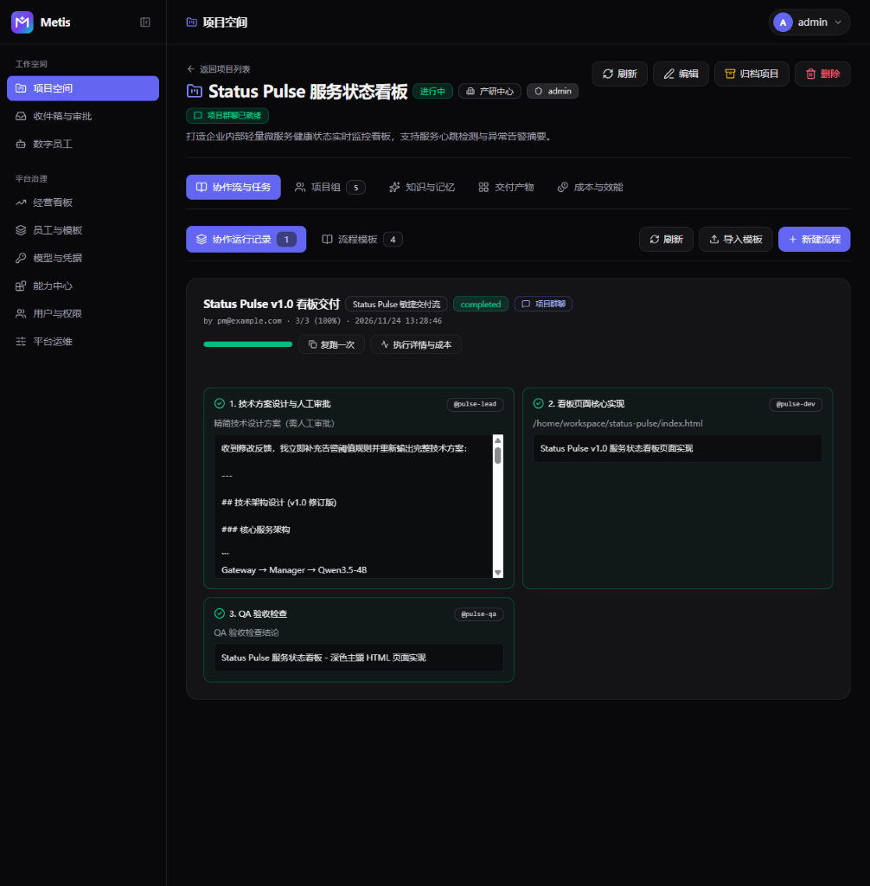
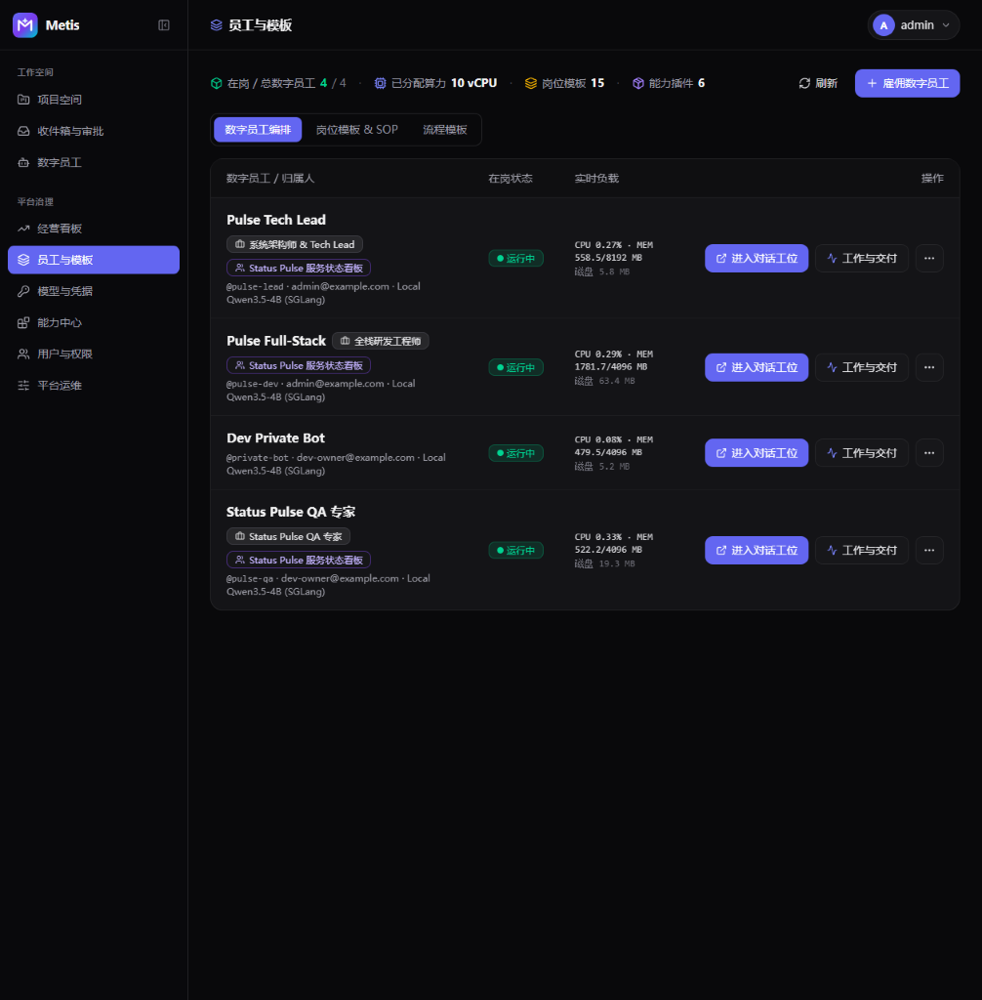
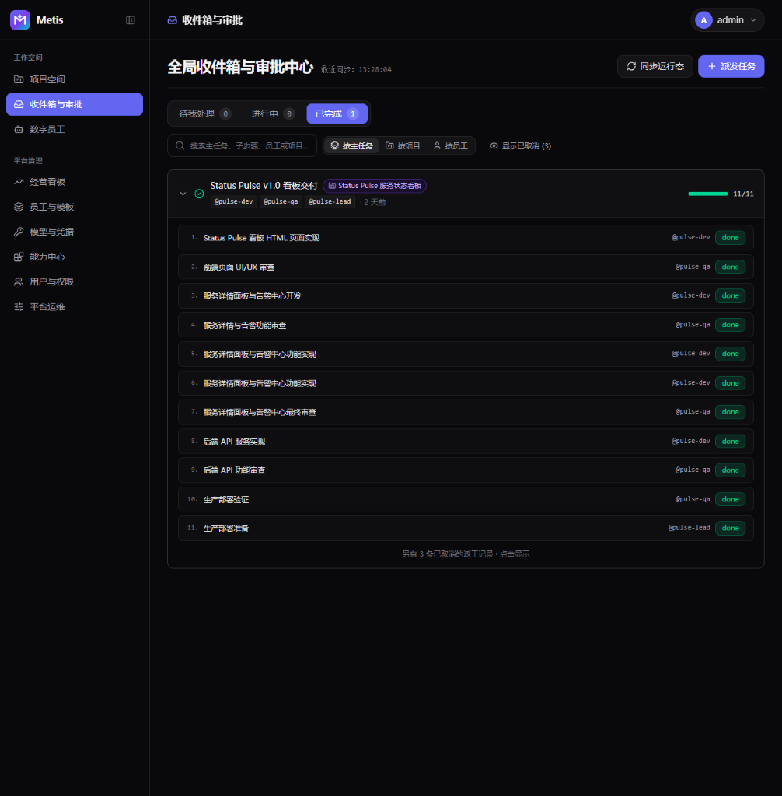
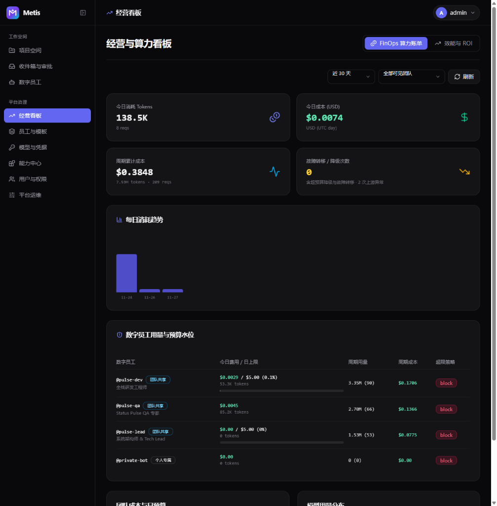
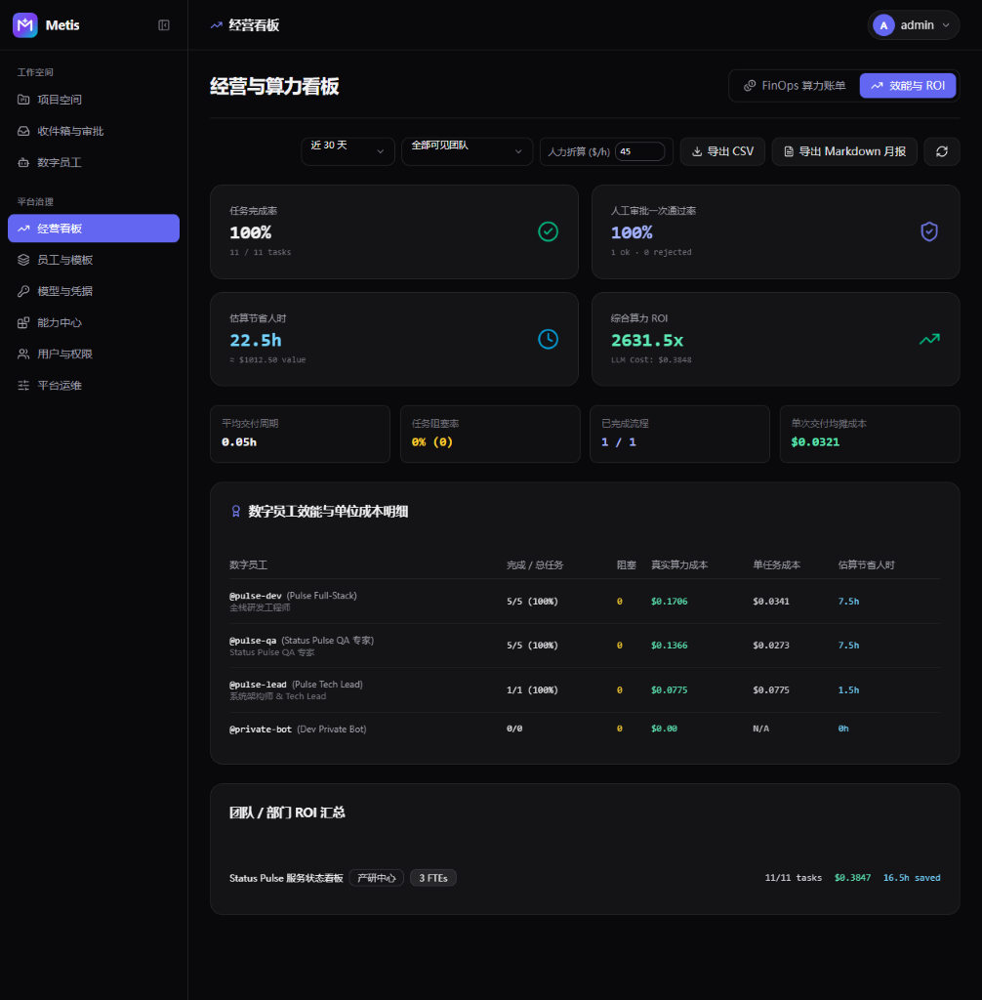
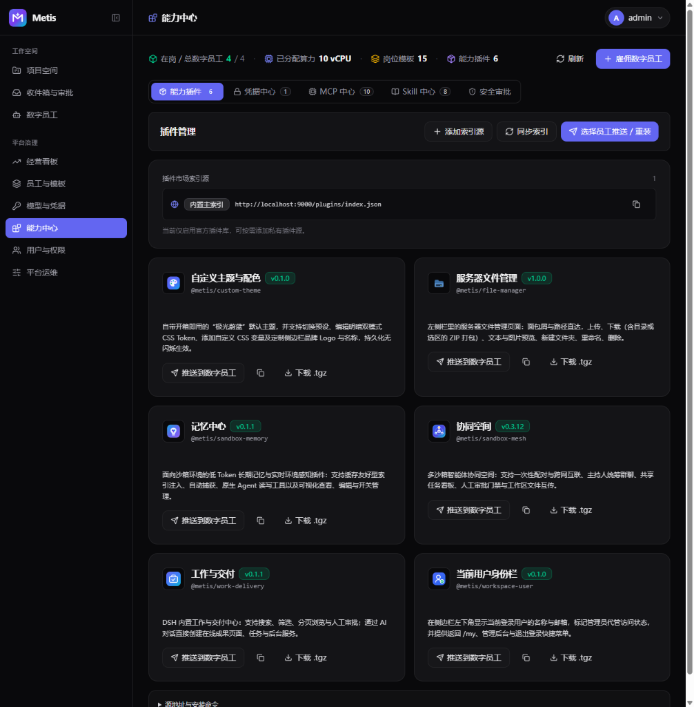
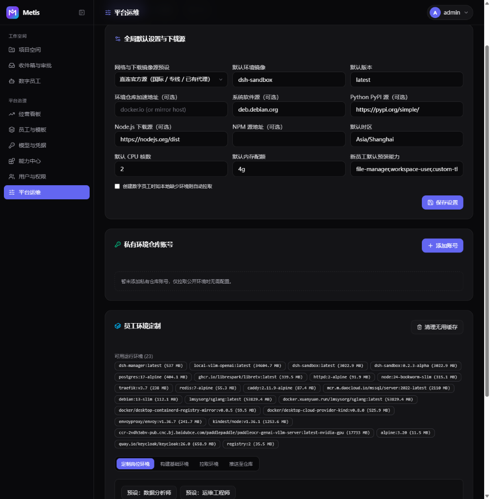
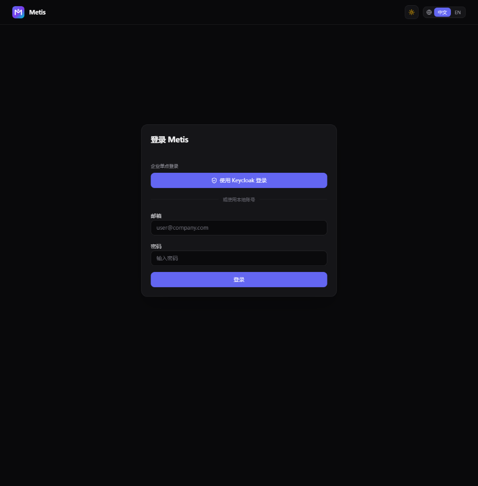

<p align="center">
  
</p>

<h1 align="center">Metis</h1>

<p align="center">
  <strong>自托管企业级数字员工云与多智能体协同平台</strong><br/>
  让 AI 从“单点聊天工具”进化为可编排、可协同、有审批、可计费的企业数字团队 —— 两条命令开箱启动，浏览器内 3 步完成全套初始化。
</p>

<p align="center">
  <a href="LICENSE"></a>
  
  
  
  
  
</p>

<p align="center">
  <a href="README.md">English</a> · <strong>简体中文</strong>
</p>

<p align="center">
  <a href="#为什么选择-metis">为什么选择 Metis</a> ·
  <a href="#产品界面预览">产品界面预览</a> ·
  <a href="#60-秒开箱体验">60 秒开箱体验</a> ·
  <a href="#核心产品能力">核心产品能力</a> ·
  <a href="#系统架构">系统架构</a> ·
  <a href="#自动化测试">自动化测试</a>
</p>

---

<p align="center">
  
</p>

<p align="center">
  <sub>在 Metis 项目空间中运行的多角色敏捷交付流：架构师（@pulse-lead）设计方案并经人工审批，全栈研发（@pulse-dev）与测试专家（@pulse-qa）自动接力完成代码实现与质量验收。</sub>
</p>

---

## 为什么选择 Metis

普通的单机 AI 助手往往各自为战：上下文无法共享、明文存放 API Key、缺少高危操作审批边界，也很难在团队内标准化推广。**Metis** 为企业打造了一套即开即用的数字员工操作系统与协同控制平面：

- **真正开箱即用，告别繁琐命令行运维**：无需手写 `.env` 密钥或预先打包镜像，直接 `docker compose up -d` 即可拉起整套平台。内置 **3 步引导向导**，自动完成管理员初始化、国内加速源切换、基础环境下载/构建，以及首个大模型连通性测试；后续在界面即可定制岗位专属环境并接入私有仓库。
- **跨角色项目空间与自动化协作流程**：一键将多名数字员工组成项目组，自动建立加密互信（`sandbox-mesh`）与共享知识目录，支持并行阶段、前置依赖、超时自动重试/打回返工、定时排班与外部事件触发。
- **零信任大模型网关 + 敏感防护 + ROI 看板**：上游 API Key 永不进入数字员工运行环境。精准计量流式 Token 与缓存读写成本，支持多 Key 池与异常自动熔断切换、外发敏感信息自动脱敏/拦截、按日/月美元预算限额，并一键导出管理层 ROI 月报。
- **企业级安全与多节点协同**：统一单入口登录自动按角色分流，支持多企业单点登录（SSO）、敏感操作人工审批、GitHub App 短期令牌自动续期、MCP 与 Skill 技能包热分发，以及 PostgreSQL / SQL Server / Redis 多 Worker 高可用架构。

---

## 产品界面预览

<table>
  <tr>
    <td width="50%" valign="top">
      <a href="docs/images/digital-workforce.png"></a>
      <br />
      <strong>数字员工编排与实时监控</strong><br />
      <sub>直观查看在岗状态、CPU/内存/磁盘负载、绑定模型与闲置自动休眠策略，一键唤醒并进入数字员工工位或交付中心。</sub>
    </td>
    <td width="50%" valign="top">
      <a href="docs/images/inbox-tasks.png"></a>
      <br />
      <strong>全局收件箱与审批中心</strong><br />
      <sub>按主任务、项目或员工聚合跨角色协同进度，集中审批关键交付节点、阻塞求助与敏感工具调用请求。</sub>
    </td>
  </tr>
  <tr>
    <td width="50%" valign="top">
      <a href="docs/images/finops-ledger.png"></a>
      <br />
      <strong>算力账单与预算保护</strong><br />
      <sub>按天、按员工、按模型实时追踪真实 Token 消耗与美元成本，支持每分钟请求/令牌限流以及超限自动停用或降级备选模型。</sub>
    </td>
    <td width="50%" valign="top">
      <a href="docs/images/roi-scorecard.png"></a>
      <br />
      <strong>效能评估与 ROI 经营看板</strong><br />
      <sub>量化呈现任务完成率、审批一次通过率、节省人时与综合算力回报率（ROI），支持一键导出 CSV 与 Markdown 月报。</sub>
    </td>
  </tr>
  <tr>
    <td width="50%" valign="top">
      <a href="docs/images/capabilities-center.png"></a>
      <br />
      <strong>统一能力中心（插件 / 凭证 / MCP / Skill）</strong><br />
      <sub>一站式管理 6 个内置协同插件、加密凭证库、10 套内置 MCP 工具、Skill 技能压缩包与敏感操作审批规则，实时热下发零重启生效。</sub>
    </td>
    <td width="50%" valign="top">
      <a href="docs/images/environment-builder.png"></a>
      <br />
      <strong>全界面环境定制与私有仓库管理</strong><br />
      <sub>在后台实时切换网络下载源、加密托管私有容器仓库账号、一键构建基础环境或按岗位定制工具环境，修改即刻同步至全部节点。</sub>
    </td>
  </tr>
</table>

<details>
<summary><strong>点击查看统一登录入口（支持企业单点登录 + 邮箱密码）</strong></summary>
<p align="center">
  
</p>
</details>

---

## 60 秒开箱体验

### 零配置快速启动（推荐）

无需提前生成随机密钥，也无需先手动构建员工镜像：

```bash
git clone https://github.com/wangchengxin666/metis.git
cd metis/manager
docker compose up -d --build
```

> **国内网络环境建议开启镜像加速构建：**
> ```bash
> APT_MIRROR=https://mirrors.aliyun.com \
> PIP_INDEX_URL=https://mirrors.aliyun.com/pypi/simple/ \
> NPM_REGISTRY=https://registry.npmmirror.com \
> docker compose up -d --build
> ```

1. 查看控制台日志获取一次性 **Setup Code**（同时保存在 `/data/INITIAL_SETUP_CODE.txt`）：
   ```bash
   docker compose logs manager | grep "Setup Code"
   ```
2. 浏览器访问 **`http://localhost:9000`**。
3. 跟随 **3 步引导向导** 即可启用全部功能：
   - **第 1 步**：输入 Setup Code，设置平台管理员邮箱与密码，配置品牌名称与网络加速预设。
   - **第 2 步**：直接在界面一键拉取或从本地源码构建数字员工基础环境。
   - **第 3 步**：接入首个大模型（支持 OpenAI、Anthropic、Gemini 或本地 SGLang / vLLM），测试连通性通过后直接进入工作台。

### 可选企业级外部基础设施对接（`manager/.env`）

仅当需要连接外部数据库、Kubernetes 集群或远程 Docker 宿主机时，复制 [manager/.env.example](manager/.env.example) 为 `manager/.env` 按需覆盖即可：

- **多关系型数据库（`DATABASE_URL`）**：默认内置 PostgreSQL 17，支持 **Microsoft SQL Server**（`mssql+pymssql://...` / `mssql://...`）、MySQL 以及单机 SQLite（`ALLOW_SQLITE=true`）。
- **Kubernetes 集群调度（`SANDBOX_RUNTIME=kubernetes`）**：为每位数字员工自动编排 `StatefulSet` + `PVC` + `Service`，并自动同步私有仓库 `ImagePullSecret`，详见 [deploy/kubernetes](deploy/kubernetes)。
- **远程 Docker 宿主机（`DOCKER_HOST=tcp://...`）**：支持基于 TLS 证书跨机安全编排，并由 Traefik 动态路由。

---

## 核心产品能力

### 1. 项目协同空间与自动化协作流程
- **14+ 覆盖全公司的标准岗位模板**：涵盖**研发产研**（架构师/Tech Lead、全栈、前端、后端、QA 测试、DevOps/SRE、产品经理、安全审计）与**职能业务**（高管助理、财务分析、法务合规、HR 专员、市场运营、BI 数据分析），开箱即带岗位职责名片与作业规范（SOP）。
- **可视化多阶段协作流程**：支持表单化启动、并行分组、前置依赖编排、条件跳过、阶段超时自动重试与打回返工路由、跨员工文件产物自动中继、定时触发计划以及签名回调链接。
- **组织记忆与知识检索**：沉淀优秀数字员工的长期记忆，审核晋升为团队共享知识文档或标准 SOP，并在流程执行前自动检索关联经验注入上下文。

### 2. 零信任模型网关与经营成本治理
- **多协议模型统一托管**：同时兼容 OpenAI Completions / Responses、Anthropic Messages 与 Google Gemini 接口，真实密钥隔离保管于控制平面。
- **高可用调度与安全防护**：支持多上游密钥池加权轮询、429/5xx 故障熔断切换、流式 Token 与缓存命中精准计费、外发敏感信息自动脱敏或阻断，以及日/月预算上限保护。

### 3. 全链路安全与团队管理
- **统一单入口登录与企业单点登录（SSO）**：支持对接多个企业 SSO（Keycloak、Okta、Authentik、飞书、企微等），按账号权限自动分流至项目工作空间或治理台，支持邮箱域名白名单与连通性验证。
- **敏感操作人工审批防线**：基于通配符与参数正则匹配拦截高危命令或工具调用（如 `git push`、`rm -rf`、`DROP TABLE`），支持在收件箱或飞书/企微/Slack 内一键放行或拒绝。
- **开发凭证库与 GitHub App**：加密保管代码仓库 PAT、SSH 私钥、环境变量与 GitHub App 凭据（后台自动签发并续期短期令牌）；提供 10 套内置 MCP 与支持 `.zip` 附属资源的 Skill 管理。

### 4. 免命令行运维与环境定制
- **配置热同步**：全局默认资源配额、默认预装能力与下载镜像源修改后，通过 Redis 版本号实时广播至所有控制面 Worker 与后续员工实例。
- **私有仓库加密凭据与环境工厂**：支持 Docker Hub、GHCR、阿里云 ACR、Harbor 及私有 Registry v2 加密登录验证，可在界面一键拉取基础环境、构建全量基础镜像或秒级构建岗位定制环境并推送私有仓库。

---

## 系统架构

```text
                        ┌──────────────────────────────────────────────────────────┐
                        │            Traefik v3.7 统一网关 (:9000)                 │
                        │          单域名动态 HTTP Provider + ForwardAuth           │
                        └────────────┬────────────────────────────────┬────────────┘
                                     │                                │
         /, /projects, /inbox,       │                                │ /s/<slug>/*
         /admin/*, /api/*, /v1/*     ▼                                ▼
         ┌────────────────────────────────────────┐    ┌───────────────────────────────────┐
         │ Metis 控制平面（多 Worker，:9000）     │    │ 数字员工独立环境（容器 / Pod）    │
         │ · FastAPI 领域路由 + 零信任模型网关     │    │ · Docker / 远程 TLS / Kubernetes  │
         │ · PostgreSQL / SQL Server / SQLite     │    │ · Caddy + Agent OS（网关鉴权）     │
         │ · Redis 分布式协同、调度锁与限流       │    │ · 用户级守护进程 + 定时任务 + Mesh│
         │ · React 19 + Tailwind v4 产品控制台    │    │ · /home/workspace 持久化磁盘      │
         │ · 插件仓库、加密凭证库与快照中心       │    │ · 全程不暴露真实上游模型密钥       │
         └────────────────────────────────────────┘    └───────────────────────────────────┘
```

### 仓库结构

```text
.
├── LICENSE                         # MIT 开源协议
├── README.md                       # 英文文档
├── README.zh-CN.md                 # 中文文档
├── docs/images/                    # 产品界面高清截图
├── deploy/kubernetes/              # Kubernetes 部署编排与说明
├── manager/                        # Metis 控制平面、Traefik 网关与 React 19 前端
│   ├── app/
│   │   ├── main.py                 # FastAPI 入口、生命周期、调度器与前端托管
│   │   ├── runtime_secrets.py      # 多 Worker 自动密钥生成与共享持久化
│   │   ├── routers/                # system, auth, setup, images, plugins, admin, sandboxes, workforce, llm_gateway
│   │   ├── services/               # bootstrap, images, playbooks, gateway, policies, memory, vault, audit
│   │   └── runtime/                # Docker、远程 TLS Docker、Kubernetes、Traefik HTTP Provider
│   ├── frontend/                   # React 19 + TypeScript + Vite 7 + Tailwind v4 SPA
│   ├── tests/                      # 完整 pytest 自动化测试套件（86 项用例）
│   ├── docker-compose.yml          # 开箱即用编排（Traefik + Manager + PostgreSQL 17 + Redis 7）
│   └── .env.example                # 可选基础设施配置模板
├── sandbox/                        # 数字员工基础镜像、Caddy、内置工具链与脚本
└── plugins/                        # 热挂载内置 @metis/* 插件（文件管理、协同空间、记忆中心、工作交付等）
```

---

## 更多文档

| 主题 | 文档链接 |
| --- | --- |
| 控制面与多后端部署 | [manager/README.md](manager/README.md) |
| Kubernetes 集群部署 | [deploy/kubernetes](deploy/kubernetes) |
| 数字员工运行时与工具链 | [sandbox/README.md](sandbox/README.md) · [sandbox/toolchain/README.md](sandbox/toolchain/README.md) |
| 系统架构与流量路径 | [sandbox/docs/architecture.md](sandbox/docs/architecture.md) |
| 构建与日常运维 | [sandbox/docs/operations.md](sandbox/docs/operations.md) |
| 在线服务与预览发布 | [sandbox/docs/services.md](sandbox/docs/services.md) |
| 企业 OIDC / SSO 对接 | [sandbox/docs/OIDC.md](sandbox/docs/OIDC.md) |
| 安全模型与权限边界 | [sandbox/docs/security.md](sandbox/docs/security.md) |
| 内置 `@metis/*` 插件 | [plugins/README.md](plugins/README.md) |

---

## 自动化测试

### 后端测试（`pytest`）

```bash
cd manager
python3 -m venv .venv
source .venv/bin/activate   # Windows: .venv\Scripts\activate
pip install -r requirements-dev.txt
pytest -v
```

### 前端检查与构建（`Yarn 4` + `Node >= 24`）

```bash
cd manager/frontend
corepack yarn install --immutable
corepack yarn typecheck
corepack yarn test
corepack yarn build
```

### 运行时与插件测试

```bash
node --test sandbox/tests/test_gateway_auth.mjs sandbox/tests/test_metis_dsh_config.mjs
docker run --rm --entrypoint /bin/bash -v "$PWD:/repo:ro" dsh-sandbox:latest \
  /repo/sandbox/tests/test_sandbox_scripts.sh /repo
```

---

## 开源协议

基于 [MIT License](LICENSE) 开源。
